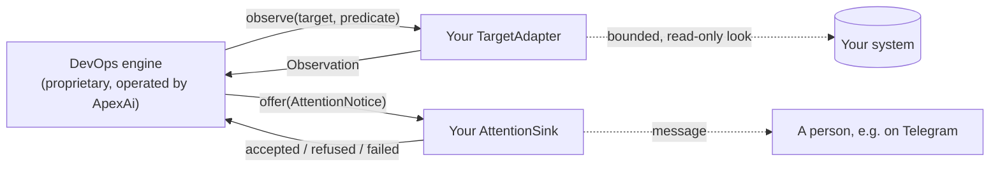

# ApexAi DevOps SDK

[](https://github.com/ApexAiOfficial/devops-sdk/actions/workflows/ci.yml)
[](LICENSE)

`apexai-devops-sdk` is the open-source Python library for connecting your own systems to the
ApexAi DevOps engine: the host contract the engine works through, ready-made adapters and an alert
sink, and an offline kit for testing your own adapters against that contract.

## Status

| | Today |
|---|---|
| **Source** | Public on GitHub under the [Apache License 2.0](LICENSE). |
| **Version** | `0.1.1`, alpha. Pre-1.0: a minor version may change the API. Host contract version `1`. |
| **Releases** | Git tags `v0.1.0` and `v0.1.1`. There is no GitHub release and no published wheel. |
| **Package indexes** | Not on PyPI or any other package index. Install from a tag, as shown [below](#installation). |
| **Runtime** | Python 3.11 or later, on Linux. No dependencies beyond the standard library. |
| **The DevOps engine** | Required for real operation. It is proprietary, in development, and runs only in environments ApexAi operates: it is **not distributed, licensed or sold** to customers. For customers, DevOps is planned as an ApexAi-managed service; there is no hosted service, sign-up, or public endpoint yet. |
| **Useful without the engine** | Building and testing adapters, one-off observations, status-file reads, Telegram delivery, and the contract checks with their offline fakes. See [what needs the engine](#what-works-without-the-engine). |

The SDK is listed with ApexAi's other developer kits at
[apexaiofficial.com/apexsdk](https://apexaiofficial.com/apexsdk). The product it connects to is
described, with its current status, at [apexaiofficial.com/devops](https://apexaiofficial.com/devops).

## Contents

- [What is in the SDK](#what-is-in-the-sdk)
- [What works without the engine](#what-works-without-the-engine)
- [Requirements](#requirements)
- [Installation](#installation)
- [Quick start](#quick-start)
- [Core concepts](#core-concepts)
- [Write your own adapter](#write-your-own-adapter)
- [Read a status file](#read-a-status-file)
- [Deliver attention notices to Telegram](#deliver-attention-notices-to-telegram)
- [Settings and secrets](#settings-and-secrets)
- [Run under the engine](#run-under-the-engine)
- [Errors and troubleshooting](#errors-and-troubleshooting)
- [Security and privacy](#security-and-privacy)
- [Versioning and compatibility](#versioning-and-compatibility)
- [Documentation](#documentation)
- [Support](#support)
- [Contributing](#contributing)
- [License](#license)

## What is in the SDK

| Module | What it provides |
|---|---|
| `apexai_devops_sdk.contract` | The host contract: `Observation`, `Outcome`, `Remedy`, the `TargetAdapter` and `AttentionSink` protocols, `AttentionNotice`, `SinkOutcome`, `utc_timestamp`, `ContractError`. Re-exported from `apexai_devops_sdk`. |
| `apexai_devops_sdk.compose` | `ComposeHealthAdapter`: watches Docker Compose service containers through the Docker Engine API (running state and the image's own `HEALTHCHECK`). |
| `apexai_devops_sdk.statusfile` | `read_json_status`: a bounded, link-safe read of a JSON status file that another process writes. |
| `apexai_devops_sdk.telegram` | `TelegramAttentionSink`: delivers attention notices to Telegram chats, at least once and de-duplicated. |
| `apexai_devops_sdk.config` | Settings parsing that refuses rather than guesses (`SettingError`), and secrets read from owner-only files. |
| `apexai_devops_sdk.testing` | `assert_target_adapter` and `check_target_adapter` for your own adapter, and offline fakes: `FakeDockerDaemon`, `FakeTelegramApi`. |
| `apexai_devops_sdk.engine` | The run-time bridge to the engine (`EngineTargetAdapter`, `read_only_host_wiring`, `engine_available`, `EngineUnavailable`). |

The package has no command-line tool and does not contain the engine. It has no client for any
ApexAi service: it never contacts ApexAi and needs no ApexAi account or key.



The engine decides what to watch, how often, what a broken observation means over time, and
whether anything may be done about it. Your integration only answers the questions it is asked and
delivers the notices it is offered. [docs/architecture.md](docs/architecture.md) explains which code
belongs in the SDK, in your application, and in the engine.

## What works without the engine

| Task | With the SDK alone |
|---|---|
| Implement `TargetAdapter` and prove it with `assert_target_adapter` | Yes |
| Call an adapter directly for a one-off observation | Yes |
| Read a status file, parse settings, read owner-only secrets | Yes |
| Offer a notice to `TelegramAttentionSink` yourself | Yes |
| Use `FakeDockerDaemon` and `FakeTelegramApi` in tests | Yes |
| Observe the targets you declare on a schedule | No: the engine's job |
| Open incidents, make decisions, and offer attention notices to your sink | No: the engine's job |
| Run a registered `Remedy`, under the engine's authority and policy | No: the engine's job |
| `read_only_host_wiring`, `to_engine_observation`, `to_engine_remedy` | No: they raise `EngineUnavailable` (except `to_engine_remedy(None)`, which returns `None`) |

Nothing in the SDK schedules, retries, or acts on its own. Without the engine, an adapter answers
when you call it and a sink delivers when you offer it a notice.

## Requirements

- **Python 3.11 or later.** CI tests 3.11, 3.12 and 3.13.
- **Linux.** It is the documented target. The SDK relies on POSIX features (Unix sockets,
  `os.fork`, file ownership checks, `O_NOFOLLOW`); other systems are not tested.
- **git and network access to GitHub** to install from a tag. pip also fetches the build backend
  (`hatchling` 1.27 or later) from your package index while it builds the package.
- **For `ComposeHealthAdapter`:** a Docker Engine reachable on a Unix socket (default
  `/var/run/docker.sock`) and containers started by Docker Compose v2.
- **For `TelegramAttentionSink`:** a Telegram bot token, and chats that have started that bot.
- **Running under the engine** happens only in environments ApexAi operates. The engine is not
  distributed; see [Run under the engine](#run-under-the-engine).

No other runtime packages are needed. The `dev` extra adds `pytest`, `ruff` and `mypy` for
working on the SDK itself.

## Installation

### From a version tag (recommended)

```bash
python -m pip install "apexai-devops-sdk @ git+https://github.com/ApexAiOfficial/devops-sdk@v0.1.1"
```

Check the install:

```bash
python -c "import apexai_devops_sdk as sdk; print(sdk.__version__, sdk.CONTRACT_VERSION)"
# 0.1.1 1
```

Use `v0.1.1`. In `v0.1.0`, `check_target_adapter` raised instead of reporting an adapter whose
`observation_timeout_seconds` raises on Python 3.11 (see [CHANGELOG.md](CHANGELOG.md)).

`pip install apexai-devops-sdk` without a URL fails with "No matching distribution found",
because the package is not on PyPI.

### As a dependency of your own package

Pin the same direct reference in your `pyproject.toml`:

```toml
[project]
dependencies = [
  "apexai-devops-sdk @ git+https://github.com/ApexAiOfficial/devops-sdk@v0.1.1",
]

# Only if your package builds with hatchling, which refuses direct references by default:
[tool.hatch.metadata]
allow-direct-references = true
```

[examples/compose_monitor/pyproject.toml](examples/compose_monitor/pyproject.toml) is a complete
example.

### A hash-checked wheel built from the tag

To install without fetching from GitHub at deploy time, build the wheel once from the tag, record
its hash, and install only that file:

```bash
git clone --depth 1 --branch v0.1.1 https://github.com/ApexAiOfficial/devops-sdk.git
python -m pip wheel ./devops-sdk --no-deps -w dist
python -m pip hash dist/apexai_devops_sdk-0.1.1-py3-none-any.whl
# --hash=sha256:<the hash of the wheel you built>

echo "apexai-devops-sdk==0.1.1 --hash=sha256:<the hash of the wheel you built>" > requirements-sdk.txt
python -m pip install --no-index --find-links dist --require-hashes -r requirements-sdk.txt
```

pip then refuses any file whose hash differs from the one you recorded.

### From a clone, for development

```bash
git clone https://github.com/ApexAiOfficial/devops-sdk.git
cd devops-sdk
python -m pip install -e ".[dev]"
```

## Quick start

### Try it offline

This script needs no Docker and no engine: `FakeDockerDaemon`, from the SDK's test kit, stands in
for the Docker daemon. Save it as `quickstart.py` and run `python quickstart.py`:

```python
import json
import tempfile

from apexai_devops_sdk.compose import ComposeHealthAdapter, ComposeService
from apexai_devops_sdk.testing import FakeDockerDaemon, compose_container, http_response

with tempfile.TemporaryDirectory() as scratch, FakeDockerDaemon(scratch) as daemon:
    # The stand-in daemon answers every request with this inspect document:
    # a running container whose image health check reports "unhealthy".
    container = compose_container("running", "unhealthy", project="shop", service="app")
    socket_path = daemon.serve(http_response(200, json.dumps(container).encode()))

    adapter = ComposeHealthAdapter({"web": ComposeService("shop", "app")}, socket_path=socket_path)
    for predicate in ("service_running", "service_healthy"):
        look = adapter.observe("web", predicate)
        print(f"{predicate:16} {look.outcome:16} {look.reason_code}")
```

Output:

```text
service_running  observed_healthy running
service_healthy  observed_broken  service_unhealthy
```

### Watch a real Compose service

Point the adapter at your own Docker Engine. Target `web` below is replica 1 of service `app` in
Compose project `shop`, that is, the container `shop-app-1`:

```python
from apexai_devops_sdk.compose import ComposeHealthAdapter, ComposeService

adapter = ComposeHealthAdapter({"web": ComposeService(project="shop", service="app")})

for predicate in ("service_running", "service_healthy"):
    look = adapter.observe("web", predicate)
    print(predicate, look.outcome, look.reason_code)
```

Each `observe` makes one `GET /containers/shop-app-1/json` request on the daemon's socket, reads
only the state words and the Compose labels, and returns an `Observation`. It never raises for the
daemon's sake and never guesses: a missing container, a silent daemon, or an answer it does not
understand is `unobservable` with a reason code (see
[troubleshooting](#errors-and-troubleshooting)). The process needs access to the Docker socket,
which is root-equivalent on most hosts; see [security](#security-and-privacy).

How container states map to outcomes:

| Container | `service_running` | `service_healthy` |
|---|---|---|
| `running`, health check `healthy` | healthy | healthy |
| `running`, health check `unhealthy` | healthy | **broken** (`service_unhealthy`) |
| `running`, health check `starting` or none declared | healthy | unobservable |
| `exited`, `dead`, `restarting` | **broken** (`service_down`) | unobservable |
| `created`, `paused`, `removing` | unobservable | unobservable |
| missing, mislabelled, unreadable, daemon silent | unobservable | unobservable |

The predicate and condition names are defaults; pass `ComposePredicates(...)` to use your own.
[docs/adapters.md](docs/adapters.md) has every option.

## Core concepts

| Term | Meaning |
|---|---|
| **Target** | Something you operate: a service, a store, a queue. Named by an identifier such as `web`. |
| **Predicate** | One yes-or-no question about a target, such as `service_healthy`. |
| **Observation** | A fresh answer to one predicate on one target, now. Its `outcome` is one of four values below. |
| **Condition class** | The durable name of a broken state, such as `service_down`. |
| **Remedy** | An action your host registered with the engine for a condition class. The engine alone decides whether, when, and under what authority it runs. |
| **Attention notice** | What the engine offers your sink when a decision needs a person. Identifiers, closed words and timestamps only. |

| `Outcome` | Meaning | Can lead to a decision |
|---|---|---|
| `observed_healthy` | The predicate holds. | No |
| `observed_broken` | The predicate does not hold. | Yes, and it is the only outcome that can |
| `unobservable` | The adapter could not tell, and says why in a reason code. | No, never acted on |
| `error` | The look failed. Under the engine, an exception, a timeout or a malformed answer counts as an error. | No, never acted on |

Target, predicate, source and condition identifiers match `[A-Za-z0-9][A-Za-z0-9._:-]{0,127}`.
Reason codes and other closed words are lower case and match `[a-z0-9][a-z0-9_.:-]{0,63}`. Values
outside the contract raise `ContractError`. The full contract is in
[docs/contract.md](docs/contract.md).

## Write your own adapter

An adapter is any class with the six members of the `TargetAdapter` protocol:

| Member | Returns |
|---|---|
| `observation_timeout_seconds` | How long one observation may take. The engine may allow less, never more. |
| `observe(target_id, predicate_id)` | A fresh `Observation` of that predicate on that target. |
| `target_fingerprint(target_id)` | A stable identifier of what the target currently is. |
| `desired_revision(target_id)` | The revision of the target's desired state, or `0` if your system has none. |
| `condition_class(observation)` | The durable condition name for a broken observation. |
| `select_remedy(target_id, condition_class)` | A registered `Remedy`, or `None` for detection only. |

Every member must be bounded and read-only, safe to call in a forked child, and must never raise
for the target's sake: when it cannot tell, it returns `UNOBSERVABLE` with a reason code. It must
not copy logs, error output, environment values or response bodies into an observation.

This adapter watches queue backlogs through a reader you supply:

```python
# queue_adapter.py
from collections.abc import Callable

from apexai_devops_sdk import Observation, Outcome, Remedy, utc_timestamp

PREDICATE = "backlog_within_limit"   # a yes-or-no question about a target
CONDITION = "backlog_high"           # the durable name of the broken state


class QueueAdapter:
    """Watches queue backlogs through a reader you supply."""

    observation_timeout_seconds = 2.0

    def __init__(self, read_backlog: Callable[[str], int | None], queues: set[str],
                 *, limit: int = 1000) -> None:
        self._read, self._queues, self._limit = read_backlog, queues, limit

    def observe(self, target_id: str, predicate_id: str) -> Observation:
        def look(outcome: Outcome, reason: str) -> Observation:
            return Observation(
                target_id=target_id, predicate_id=predicate_id, outcome=outcome,
                observed_at=utc_timestamp(), source_id="queue_depth", reason_code=reason,
            )

        if target_id not in self._queues or predicate_id != PREDICATE:
            return look(Outcome.UNOBSERVABLE, "not_watched")     # never guess about the unknown
        try:
            backlog = self._read(target_id)                      # bounded and read-only
        except OSError:
            backlog = None
        if backlog is None:
            return look(Outcome.UNOBSERVABLE, "backlog_unreadable")
        if backlog > self._limit:
            return look(Outcome.OBSERVED_BROKEN, CONDITION)
        return look(Outcome.OBSERVED_HEALTHY, "backlog_ok")

    def target_fingerprint(self, target_id: str) -> str:
        return f"queue-{target_id}"

    def desired_revision(self, target_id: str) -> int:
        return 0                                                 # no desired-state revisions

    def condition_class(self, observation: Observation) -> str:
        return CONDITION

    def select_remedy(self, target_id: str, condition_class: str) -> Remedy | None:
        return None                                              # detection and attention only
```

Prove the contract in your own test suite (`pip install pytest`, then `pytest`):

```python
# test_queue_adapter.py
from apexai_devops_sdk import Outcome
from apexai_devops_sdk.testing import assert_target_adapter

from queue_adapter import PREDICATE, QueueAdapter


def test_a_long_backlog_is_broken() -> None:
    adapter = QueueAdapter(lambda queue: 5000, {"orders"})
    assert adapter.observe("orders", PREDICATE).outcome is Outcome.OBSERVED_BROKEN


def test_an_unreadable_backlog_is_unobservable() -> None:
    adapter = QueueAdapter(lambda queue: None, {"orders"})
    assert adapter.observe("orders", PREDICATE).outcome is Outcome.UNOBSERVABLE


def test_the_adapter_meets_the_contract() -> None:
    for backlog in (5, 5000, None):
        adapter = QueueAdapter(lambda queue, n=backlog: n, {"orders"})
        assert_target_adapter(adapter, targets=["orders"], predicates=[PREDICATE])
```

For every declared target and predicate, `assert_target_adapter` checks that:

- `observe` answers twice in a row with an `Observation` for the same target and predicate, within
  `observation_timeout_seconds`;
- `target_fingerprint` is a stable identifier and `desired_revision` a non-negative integer;
- `condition_class` and `select_remedy` handle a broken observation, including a synthetic one,
  and any remedy is for that same condition.

It also checks, once, that `observe` answers in a forked child for the first declared target and
predicate (`forked=False` skips that), and that an unknown target and an unknown predicate are never
observed conclusively.

It raises one `AssertionError` listing every violation. `check_target_adapter` takes the same
arguments and returns the list instead. The checks judge the contract only: whether a given state
should count as broken is your own test to write, as the first two tests above do.

[examples/custom_adapter.py](examples/custom_adapter.py) is a complete adapter for a service that
writes a heartbeat file, with its contract test. Run it with `pytest examples/custom_adapter.py`
from a clone.

## Read a status file

Where an orchestrator or sidecar already writes a small JSON document per target, reading it is
the least-privileged way to observe: one file read, no network, no daemon access.

```python
from apexai_devops_sdk.statusfile import read_json_status

read = read_json_status("/srv/app/state/web.json", prefix="state")
if read.ok:
    observed = read.document.get("observed")     # what the values mean is your adapter's call
else:
    reason = read.refusal                        # e.g. state_missing, state_unsafe
```

The file is opened without following a symbolic link, must be a regular file that neither its
group nor others can write, is read up to `max_bytes` (64 KiB by default), and must hold one JSON
object. Pass `trusted_owners={uid, ...}` to also require the writer's account. Every failure is a
closed refusal code: `<prefix>_missing`, `_unreadable`, `_not_a_file`, `_unsafe`, `_oversized` or
`_malformed`. It never raises for the file's sake and never copies file content into a refusal.

## Deliver attention notices to Telegram

`TelegramAttentionSink` implements `AttentionSink` over the Bot API's `sendMessage`. This runs
offline against `FakeTelegramApi`, a stand-in Bot API on loopback, with a synthetic token:

```python
import tempfile
from pathlib import Path

from apexai_devops_sdk import AttentionNotice
from apexai_devops_sdk.telegram import TelegramAttentionSink
from apexai_devops_sdk.testing import FakeTelegramApi

with tempfile.TemporaryDirectory() as scratch, FakeTelegramApi(scratch) as api:
    root = Path(scratch)
    token_file = root / "telegram.env"
    token_file.touch(mode=0o600)
    token_file.write_text("TELEGRAM_BOT_TOKEN=123456789:" + "A" * 35 + "\n")  # synthetic token
    state_dir = root / "attention"
    state_dir.mkdir(mode=0o700)

    sink = TelegramAttentionSink(
        token_file=token_file, chat_ids=[100000001], state_dir=state_dir,
        api_base=api.base_url,  # the stand-in on loopback; omit it to use api.telegram.org
    )
    assert sink.check()  # the token file and state directory are usable

    notice = AttentionNotice(
        notification_id="ntf_0123456789abcdef", work_id="work-1", attention_kind="blocker",
        incident_id="incident-1", desired_revision=0, target_id="web",
        decision_state="blocked", reason_code="service_down", recovery_kind=None,
        attempt=1, settled_at=None,
    )
    print(sink.offer(notice))   # accepted
    print(sink.offer(notice))   # accepted: already delivered, not sent again
    print(len(api.requests()), "message sent")
```

Output:

```text
accepted
accepted
1 message sent
```

In production:

- **Token file:** an absolute path to a regular file owned by the user running the sink, with no
  group or other permissions (mode `0600`), holding a `TELEGRAM_BOT_TOKEN=<token>` line
  (`token_key=` names another key). The token is read from the file each time it is needed and is
  never kept in the sink, logged or returned.
- **State directory:** an absolute path to a directory owned by that user and writable by no one
  else. One marker file per notice and chat makes delivery at least once and de-duplicated across
  crashes. Markers are never pruned; rotating them is the operator's job.
- **Chats:** each chat must have started the bot. Call `sink.check()` at start-up and refuse to
  run if it returns `False`.

`offer` answers `accepted` (delivered, or already delivered, to at least one chat, with no chat
left to retry), `refused` (every chat refused it with a 400 or 403; never offered again) or
`failed` (offered again later; chats already told are skipped). The message is plain
text built from the notice's identifiers and closed words; pass `render=` for your own wording.
[docs/adapters.md](docs/adapters.md) has the full delivery rules.

## Settings and secrets

`apexai_devops_sdk.config` parses settings from any mapping, such as `os.environ`, and raises
`SettingError` naming the setting, never its value:

| Helper | Returns |
|---|---|
| `setting(environ, name, default="")` | The stripped value, or `default` when unset or blank. |
| `absolute_path(environ, name, default="")` | A `Path`; refuses a relative or empty one. |
| `identifiers(environ, name)` | A tuple of distinct, comma-separated contract identifiers. |
| `integers(environ, name)` | A tuple of distinct, non-zero integers, such as chat ids. |
| `environment_key(value, name=...)` | An `UPPER_CASE` key name. |
| `read_secret_file(path, key, pattern=None)` | One value from an owner-only `KEY=value` file, or `None`. |
| `private_directory(path)` | Whether `path` is a real directory owned by this user and writable by no one else. |

```python
from apexai_devops_sdk.config import SettingError, integers

integers({"CHAT_IDS": "100000001, 100000002"}, "CHAT_IDS")  # (100000001, 100000002)

try:
    integers({"CHAT_IDS": "100000001,abc"}, "CHAT_IDS")
except SettingError as error:
    print(error)  # CHAT_IDS must be comma-separated integers
```

`read_secret_file` returns `None`, without saying why, for a file that is a symbolic link, is not
owned by the running user, has any group or other permission bits, exceeds 4 KiB, lacks the key, or
holds a value that does not match `pattern`. Secret files hold plain `KEY=value` lines: no
`export`, no quotes; `#` comments and blank lines are skipped.

## Run under the engine

> The engine runs only in environments ApexAi operates and is not distributed, licensed or sold; it
> is in development, and DevOps for customers is planned as an ApexAi-managed service. This section
> documents the `engine` module for host packages the engine loads there. Anywhere else, the code
> below stops at `EngineUnavailable`.

The engine loads a host package through a Python entry point named `runtime`, which returns the
engine's wiring for that host. `read_only_host_wiring` builds the wiring for a monitor that
observes and alerts but never acts: its standing policy is disabled and allows no action and no
target, its action registry is empty, and no remedy is ever admitted.

```python
# my_monitor/wiring.py: the host package's runtime entry point
import os

from apexai_devops_sdk.compose import ComposeHealthAdapter, ComposeService
from apexai_devops_sdk.engine import read_only_host_wiring
from apexai_devops_sdk.telegram import TelegramAttentionSink


def runtime():
    adapter = ComposeHealthAdapter({"web": ComposeService("shop", "app")})
    sink = TelegramAttentionSink(
        token_file="/etc/my-monitor/telegram.env",       # owner-only KEY=value file
        chat_ids=[int(os.environ["MY_MONITOR_CHAT_ID"])],
        state_dir="/var/lib/my-monitor/attention",       # private to the monitor's user
    )
    if not sink.check():
        raise RuntimeError("the attention sink cannot deliver")
    return read_only_host_wiring(
        adapter,
        controller_id=os.environ["MY_MONITOR_CONTROLLER_ID"],
        policy_revision="read-only-r1",
        attention_sink=sink,
    )
```

- `controller_id` is the monitor's machine identity; its format is
  `apexai_devops_sdk.engine.CONTROLLER_ID`. `policy_revision` is an identifier.
- [examples/compose_monitor/](examples/compose_monitor/) is a complete host package of this kind,
  configured from `MONITOR_*` settings, with its entry-point declaration in its `pyproject.toml`.
- `engine_available()` reports whether the engine's host interface can be imported.
  [tests/test_engine_live.py](tests/test_engine_live.py) is the agreement check between an SDK
  version and an engine version in an ApexAi-operated environment; it is skipped everywhere else,
  including this repository's CI.

## Errors and troubleshooting

### Exceptions

| Exception | Base | Raised when |
|---|---|---|
| `ContractError` | `ValueError` | A value is outside the host contract, or a constructor or function gets an invalid argument. The message names the field, never its content. |
| `SettingError` | `ValueError` | A `config` helper refuses a setting. The message names the setting, never its value. |
| `EngineUnavailable` | `RuntimeError` | A bridge function that needs the engine is called where the engine's host interface is absent, or fails to import. |
| `AssertionError` | | `assert_target_adapter` found contract violations. |

Adapters and sinks do not raise for the target's sake. Problems with the observed system come back
as an `unobservable` observation with a reason code, as a status-file refusal code, or as a sink
answer of `failed` or `refused`.

### Retries

The SDK does not retry. `ComposeHealthAdapter` makes one request per `observe`, inside a 3-second
deadline by default (`deadline_seconds=`). `TelegramAttentionSink` makes at most one request per
chat per `offer`, inside a 1.5-second deadline for the whole offer by default. Under the engine, a
`failed` offer is offered again later, each retry starting at a different chat so one slow chat
cannot starve the others. Without the engine, retrying is up to the caller.

### Compose reason codes

| Reason code | Cause |
|---|---|
| `target_unknown`, `predicate_unknown` | The target or predicate is not one the adapter was configured with. |
| `daemon_unreachable` | The socket does not exist or the process may not connect to it. |
| `daemon_timeout` | The daemon did not answer within the deadline. |
| `container_missing` | No container named `<project>-<service>-<index>`. Compose v1 names, a custom `container_name`, and other replicas are not matched; set `ComposeService(..., index=N)` for a replica. |
| `container_mismatch` | The container lacks matching `com.docker.compose.project` and `com.docker.compose.service` labels. |
| `container_<state>` | The container is `created`, `paused` or `removing`, or, for the health predicate, not running. |
| `health_starting`, `health_undeclared` | The health check is still starting, or the image declares none. |
| `daemon_refused`, `response_malformed`, `response_oversized`, `state_unrecognised` | The daemon answered with an error status, an unreadable or over-256-KiB answer, or a state word the adapter does not know. |

### Common problems

| Symptom | Cause and fix |
|---|---|
| `pip install apexai-devops-sdk` reports "No matching distribution found" | The package is not on PyPI. [Install from a tag](#installation). |
| `RuntimeError: the fake daemon did not start`, with `OSError: AF_UNIX path too long` above it | The directory given to `FakeDockerDaemon` is too long for a Unix socket path (about 108 bytes on Linux). Use a short directory, such as `tempfile.TemporaryDirectory()` with the default temporary directory. |
| `sink.check()` returns `False` | The token file is a symbolic link, is not owned by the running user, has group or other permissions (use mode `0600`), lacks the key, or holds a value that is not a bot token; or the state directory is missing, not owned by that user, writable by others, or not writable by the sink. |
| `ContractError: telegram: api_base must be an https origin (http on loopback)` | `api_base` must be an `https://` origin with no path; plain `http://` is accepted only on loopback, for tests. |
| `EngineUnavailable: the DevOps engine's host interface is not installed` | Expected everywhere outside an ApexAi-operated engine environment. Everything outside `apexai_devops_sdk.engine` still works. |
| `check_target_adapter` reports `observe raised ConnectionError (answer unobservable instead)` | `observe` let an exception escape. Catch it and return `Outcome.UNOBSERVABLE` with a reason code. |
| `check_target_adapter` reports `an unknown target or predicate was observed conclusively` | `observe` answered healthy or broken for a target or predicate it does not watch. Answer `UNOBSERVABLE`. |
| On `v0.1.0` with Python 3.11, `check_target_adapter` raises instead of reporting | Fixed in `v0.1.1`. Upgrade. |

## Security and privacy

### What the SDK contacts

| Component | Contacts | When |
|---|---|---|
| `ComposeHealthAdapter` | The Docker Engine API on a local Unix socket (default `/var/run/docker.sock`): one `GET /containers/<name>/json`. | Each `observe` call. |
| `TelegramAttentionSink` | The Telegram Bot API (`https://api.telegram.org`, or the `api_base` you set): one `sendMessage` per chat still owed the notice. | Each `offer` call that has something to send. |
| `FakeDockerDaemon`, `FakeTelegramApi` | A local Unix socket and `127.0.0.1` only. | In your tests. |
| Everything else | Nothing. The `engine` module imports the engine in-process; it makes no network call. | |

The SDK has no telemetry, no ApexAi endpoint, and no ApexAi credentials.

### Handling secrets

- The Telegram bot token reaches the sink only through an owner-only file; the constructor has no
  token argument. Keep tokens and keys out of environment variables, command lines and logs.
- The Bot API carries the token in the request path, so `api_base` must be a server you trust with
  it: Telegram's, or your own Bot API server.
- `FakeTelegramApi` records each request path, which includes the token. Use synthetic tokens in
  tests, never a real one.
- `TelegramAttentionSink`'s `repr` shows only the number of chats, never the token file's path.

### What leaves your system

- Observations carry identifiers, closed words and small primitives only. `ComposeHealthAdapter`
  reads the container's state and labels and never copies its environment or health-check output.
- Telegram messages contain the notice's identifiers and closed words, including your target ids.
  Choose target ids you are willing to send to Telegram, or pass your own `render=`.

### Privilege

Access to the Docker API is root-equivalent on most hosts. Grant it to a monitor deliberately.
Reading a status file that your orchestrator writes needs no such access.
[SECURITY.md](SECURITY.md) summarizes the SDK's security properties.

### Reporting a vulnerability

Email **support@apexaiofficial.com** with what you found, how to reproduce it, and the SDK version
or commit. Do not open a public issue for a vulnerability.

## Versioning and compatibility

- **Package version.** Semantic versioning. Before 1.0, a minor version may change the API.
  Every change is recorded in [CHANGELOG.md](CHANGELOG.md).
- **Host contract version.** `apexai_devops_sdk.CONTRACT_VERSION`, currently `"1"`, is versioned
  separately. A change an existing adapter or sink would notice raises it, and the changelog says
  what to change.
- **Pin a tag.** Each version is a git tag (`v0.1.1` is current). Pin a tag or a commit, never a
  branch.
- **Python.** 3.11 or later; CI runs ruff, mypy (strict), pytest and a wheel build on 3.11, 3.12
  and 3.13.
- **Engine.** The engine is not distributed. In an ApexAi-operated environment,
  [tests/test_engine_live.py](tests/test_engine_live.py) proves that the SDK version and the engine
  version there agree.

## Documentation

| Document | Covers |
|---|---|
| [docs/contract.md](docs/contract.md) | The host contract, version 1: `TargetAdapter`, `Observation`, `Remedy`, `AttentionSink` and `AttentionNotice`. |
| [docs/adapters.md](docs/adapters.md) | `ComposeHealthAdapter`, `read_json_status`, `TelegramAttentionSink`, `config`, and the `testing` kit. |
| [docs/architecture.md](docs/architecture.md) | What belongs in the SDK, in your application, and in the engine; versioning. |
| [examples/custom_adapter.py](examples/custom_adapter.py) | A complete custom adapter with its contract test. |
| [examples/compose_monitor/](examples/compose_monitor/) | A complete read-only monitor host package. |
| [CHANGELOG.md](CHANGELOG.md) | Every version and what changed. |

## Support

- **Bugs and questions about the SDK:** [GitHub issues](https://github.com/ApexAiOfficial/devops-sdk/issues).
- **Support:** support@apexaiofficial.com.
- **Questions about DevOps itself:** sales@apexaiofficial.com. DevOps for customers is planned as
  an ApexAi-managed service; the engine is not distributed.

## Contributing

Issues and pull requests are welcome. Read [CONTRIBUTING.md](CONTRIBUTING.md) first. Before a pull
request, run the same checks as CI:

```bash
python -m pip install -e ".[dev]"
ruff check src tests examples
ruff format --check src tests examples
mypy
pytest
```

## License

The SDK is licensed under the [Apache License 2.0](LICENSE); see also [NOTICE](NOTICE). The DevOps
engine is proprietary: it is not part of this package, nothing here contains or reproduces it,
and it is not distributed, licensed or sold to customers.
